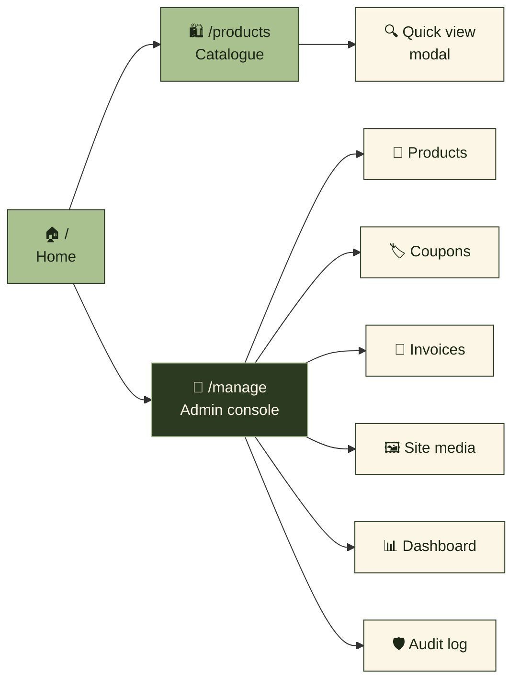
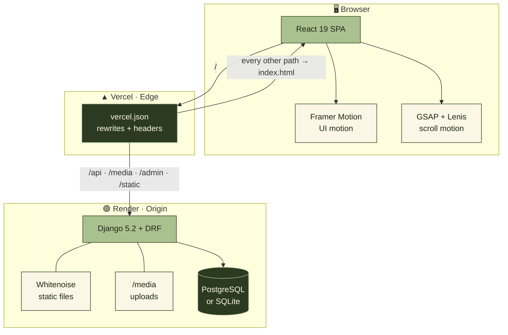
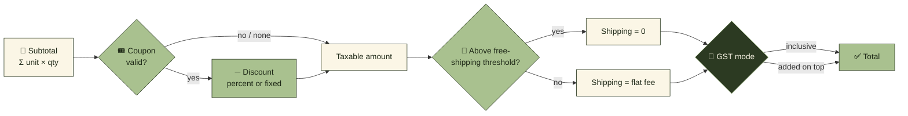
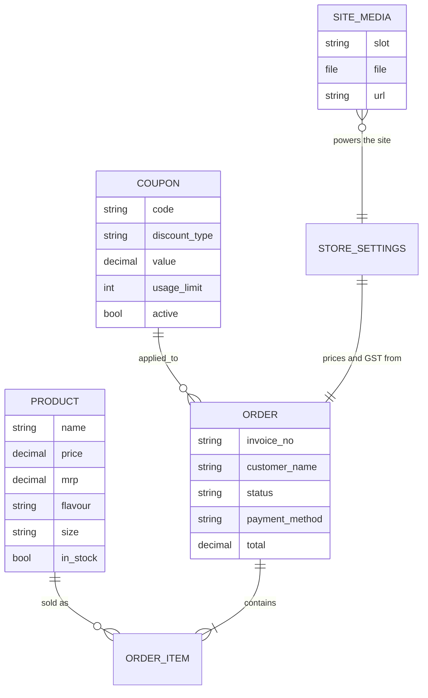
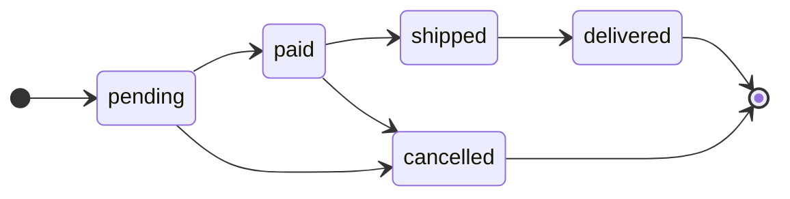
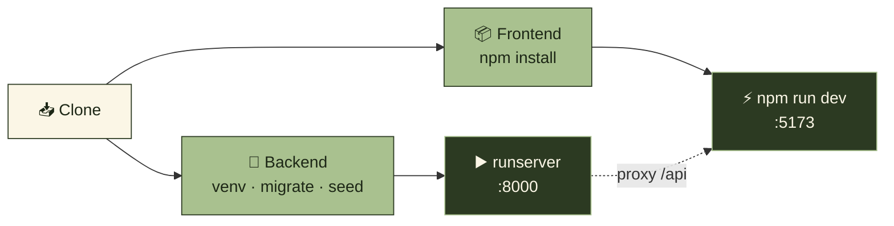
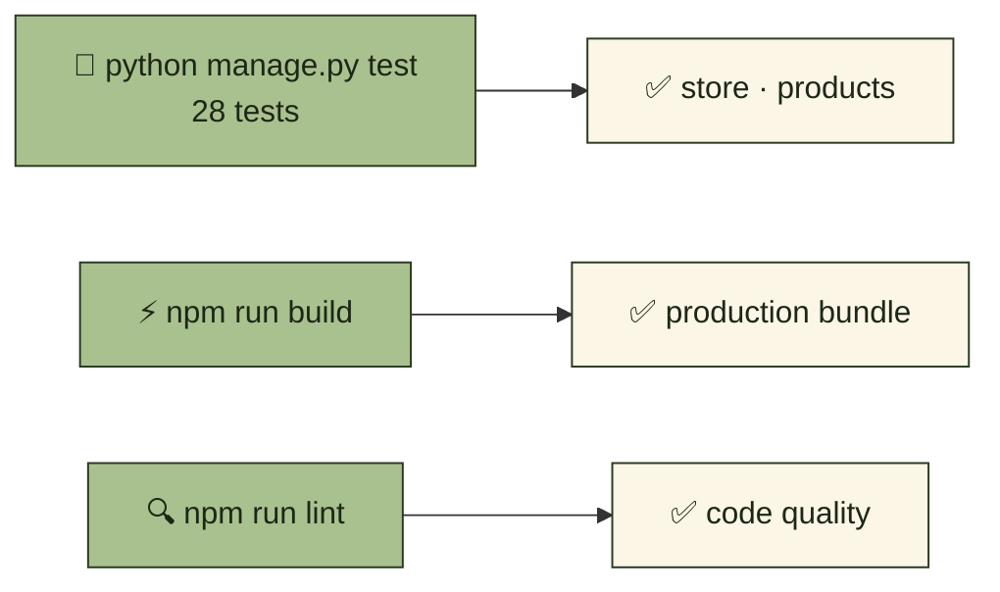
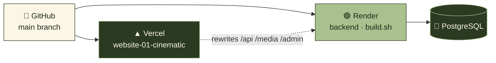
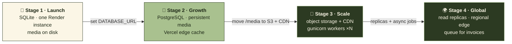

<p align="center">
  
</p>

<p align="center">
  <a href="#-website-01--massup-cinematic"></a>
  <a href="#-getting-started"></a>
  <a href="#-backend-api"></a>
  <a href="#-deployment"></a>
</p>

<p align="center">
  
  
  
  
  
  
  
  
</p>

<h3 align="center">🌿 Good fuel. Great feeling. 🌿</h3>

<p align="center">
  Five cinematic storefront concepts for one pistachio protein brand,<br/>
  sharing a production-grade Django REST backend.
</p>

---

## 🧭 Navigate

<table align="center">
<tr>
  <td align="center" width="25%"><a href="#-overview"><b>🌱 Overview</b></a></td>
  <td align="center" width="25%"><a href="#-website-01--massup-cinematic"><b>🎬 Storefront</b></a></td>
  <td align="center" width="25%"><a href="#-architecture"><b>🏗️ Architecture</b></a></td>
  <td align="center" width="25%"><a href="#-backend-api"><b>📡 API</b></a></td>
</tr>
<tr>
  <td align="center"><a href="#-data-model"><b>🗂️ Data model</b></a></td>
  <td align="center"><a href="#-getting-started"><b>🚀 Run locally</b></a></td>
  <td align="center"><a href="#-testing"><b>🧪 Testing</b></a></td>
  <td align="center"><a href="#-deployment"><b>☁️ Deploy</b></a></td>
</tr>
<tr>
  <td align="center"><a href="#-scaling-path"><b>📈 Scaling</b></a></td>
  <td align="center"><a href="#-design-system"><b>🎨 Design system</b></a></td>
  <td align="center"><a href="#-project-structure"><b>📁 Structure</b></a></td>
  <td align="center"><a href="#-troubleshooting"><b>🛠️ Troubleshooting</b></a></td>
</tr>
</table>

---

## 🌱 Overview

This repository holds **five independent front-end experiments**, each a different take on how a single product page can feel. The flagship is **Website 01 · Cinematic**, a full storefront for **MASSUP Pistachio Protein Powder**, backed by a **Django REST API** that handles the catalogue, coupons, GST-aware billing, invoices, site media, and a staff console.

<p align="center">
  
</p>

<table align="center">
<tr>
  <td align="center"><h2>5</h2>concepts</td>
  <td align="center"><h2>1</h2>shared API</td>
  <td align="center"><h2>28</h2>backend tests</td>
  <td align="center"><h2>7</h2>brand colours</td>
</tr>
</table>

### The five concepts

| # | Concept | Folder | Stack | Status |
|:-:|---------|--------|-------|:------:|
| 01 | 🎬 **Cinematic storefront** — video hero, admin, backend | [`website-01-cinematic`](website-01-cinematic) | React 19 · Framer Motion · GSAP · Lenis | ⭐ **Flagship** |
| 02 | 🏛️ Luxury editorial | [`website-02-luxury`](website-02-luxury) | React 19 · Vite | 🧪 Concept |
| 03 | 🌌 3D universe | [`website-03-3d-universe`](website-03-3d-universe) | React 19 · Vite | 🧪 Concept |
| 04 | 🎨 Creative playground | [`website-04-creative-playground`](website-04-creative-playground) | React 19 · Vite | 🧪 Concept |
| 05 | 📜 Scroll experience | [`website-05-scroll-experience`](website-05-scroll-experience) | React 19 · Vite | 🧪 Concept |
| — | ⚙️ Shared API | [`backend`](backend) | Django 5.2 · DRF · Whitenoise · Gunicorn | ✅ Production |

---

## 🎬 Website 01 · MASSUP Cinematic

<p align="center">
  <a href="website-01-cinematic"></a>
</p>

### ✨ Highlights

| | Feature | What it does |
|:-:|---------|--------------|
| 🎥 | **Cinematic hero** | Looping product video with floating pistachio macro shots |
| 🌀 | **Scroll-velocity marquees** | Text bands that speed up with scroll direction and speed |
| ✂️ | **Split-text reveals** | Headlines animate word by word as they enter view |
| 🧲 | **Magnetic buttons** | Buttons drift toward the cursor |
| 🖱️ | **Custom cursor** | A brand-coloured cursor that reacts to links and buttons |
| 🌊 | **Smooth scrolling** | Lenis, synced to GSAP ScrollTrigger |
| 🃏 | **3D product cards** | Tilt on hover with a shared-element transition into quick view |
| 🫙 | **Jar preloader** | Loading screen that fills with the product |
| 🛡️ | **Offline fallback** | Shows bundled demo products if the API is unreachable |
| 🔐 | **Admin console** | Products, coupons, invoices, billing, settings, media, audit |

### 🗺️ Pages



### 🎨 Brand palette

<table align="center">
<tr>
  <td align="center" bgcolor="#A9C18F" width="110"><br/><br/><b>Pista</b><br/><code>#A9C18F</code><br/><br/></td>
  <td align="center" bgcolor="#C9DDAE" width="110"><br/><br/><b>Pista 2</b><br/><code>#C9DDAE</code><br/><br/></td>
  <td align="center" bgcolor="#DFE9CD" width="110"><br/><br/><b>Soft</b><br/><code>#DFE9CD</code><br/><br/></td>
  <td align="center" bgcolor="#EEF4E2" width="110"><br/><br/><b>Light</b><br/><code>#EEF4E2</code><br/><br/></td>
  <td align="center" bgcolor="#FBF6E6" width="110"><br/><br/><b>Cream</b><br/><code>#FBF6E6</code><br/><br/></td>
  <td align="center" bgcolor="#687B4E" width="110"><font color="#FBF6E6"><br/><br/><b>Olive</b><br/><code>#687B4E</code><br/><br/></font></td>
  <td align="center" bgcolor="#2C3A22" width="110"><font color="#C9DDAE"><br/><br/><b>Forest</b><br/><code>#2C3A22</code><br/><br/></font></td>
</tr>
</table>

Typography pairs **Fraunces** (display serif) with **Manrope** (UI sans), both loaded through Fontsource.

---

## 🏗️ Architecture

<p align="center">
  
</p>



> **Why it works:** the browser only ever talks to one origin, so there are **no CORS round-trips** for normal page loads, and client-side routes survive a refresh.

---

## 📡 Backend API

<p align="center">
  
  
  
</p>

### 🟢 Public endpoints

| Method | Endpoint | Purpose |
|:-:|----------|---------|
|  | `/api/health/` | Liveness check |
|  | `/api/products/` | Catalogue |
|  | `/api/products/{id}/` | One product |
|  | `/api/coupons/validate/` | Check a coupon against a subtotal |
|  | `/api/site-media/` | Images and videos for every site slot |

### 🔐 Staff endpoints · token required

| Method | Endpoint | Purpose |
|:-:|----------|---------|
|  | `/api/auth/login/` | Exchange credentials for a token · **10/min** |
|  | `/api/auth/logout/` | Revoke the current token |
|  | `/api/auth/me/` | Current user |
|  | `/api/auth/change-password/` | Change password |
|  | `/api/products/…` | Manage products |
|  | `/api/coupons/…` | Manage coupons |
|  | `/api/orders/…` | Invoices · `?status=` `?q=` filters |
|   | `/api/settings/` | Read or update store settings & GST |
|   | `/api/site-media/{slot}/` | Replace or reset a media slot |
|  | `/api/dashboard/` | Dashboard summary |
|  | `/api/logs/` | Login attempts & audit trail |

### 🧮 Billing pipeline

Billing is **server-side only**. The browser never decides a total.



All money is `Decimal`, rounded to two places.

### 🛡️ Security & throttles

| Control | Value |
|---------|-------|
| 🔑 Staff token lifetime | `TOKEN_TTL_HOURS` · default **12 h**, deleted on expiry |
| 🚫 Non-staff accounts | Refused even with a valid token |
| 🐢 Throttle `anon` | **300 / min** |
| ⚡ Throttle `user` | **900 / min** |
| 🔒 Throttle `login` | **10 / min** |
| 🎟️ Throttle `coupon` | **30 / min** |
| 📝 Login attempts | Every attempt logged with IP and user agent |
| 🧾 Audit trail | Staff actions such as invoice creation are recorded |

---

## 🗂️ Data model



**Order lifecycle**



---

## 🚀 Getting started

<p align="center">
  
  
  
</p>



### 1 · Clone

```bash
git clone https://github.com/Ruchitra-Jasmatiya/animation-clash.git
cd animation-clash
```

### 2 · Backend

```bash
cd backend
python -m venv .venv
source .venv/bin/activate          # Windows: .venv\Scripts\activate
pip install -r requirements.txt

cp .env.example .env               # set SECRET_KEY and ADMIN_* values

python manage.py migrate
python manage.py ensure_admin      # staff user from ADMIN_USERNAME / ADMIN_PASSWORD
python manage.py seed_products --if-empty
python manage.py runserver         # http://127.0.0.1:8000
```

<p>
  <a href="http://127.0.0.1:8000/api/health/"></a>
</p>

### 3 · Storefront

```bash
cd website-01-cinematic
npm install
cp .env.example .env.local         # leave VITE_API_URL empty to use the dev proxy
npm run dev                        # http://localhost:5173
```

Add `VITE_DEV_API=http://127.0.0.1:8000` to `.env.local` so `/api` and `/media` reach Django.

<p>
  <a href="http://localhost:5173"></a>
  <a href="http://localhost:5173/manage"></a>
</p>

---

## 🔧 Environment variables

<details open>
<summary><b>🐍 Backend · <code>backend/.env</code></b></summary>

| Variable | Required | Example | Notes |
|----------|:--------:|---------|-------|
| `SECRET_KEY` | 🔴 prod | long random string | Never commit a real key |
| `DEBUG` | ⚪ | `False` | Keep `False` in production |
| `DATABASE_URL` | 🟡 | `postgres://…` | Falls back to SQLite if empty |
| `ADMIN_USERNAME` | 🟡 | `owner` | Used by `ensure_admin` |
| `ADMIN_PASSWORD` | 🟡 | strong password | Used by `ensure_admin` |
| `CORS_ALLOWED_ORIGINS` | 🔴 prod | `https://your-site.vercel.app` | Comma-separated |
| `CSRF_TRUSTED_ORIGINS` | 🔴 prod | `https://your-site.vercel.app` | Comma-separated |
| `TOKEN_TTL_HOURS` | ⚪ | `12` | Staff session lifetime |

</details>

<details>
<summary><b>⚡ Storefront · <code>website-01-cinematic/.env</code></b></summary>

| Variable | Default | Purpose |
|----------|---------|---------|
| `VITE_API_URL` | empty | Set only if the browser should call the API directly |
| `VITE_DEV_API` | `http://127.0.0.1:8000` | Local dev proxy target |

</details>

> 🔴 required in production · 🟡 required for some features · ⚪ optional

---

## 🧪 Testing



```bash
cd backend && python manage.py test                 # 28 backend tests
cd website-01-cinematic && npm run build && npm run lint
```

---

## ☁️ Deployment



### 🟢 Backend on Render

1. New **Web Service** → root directory `backend`
2. **Build command:** `./build.sh`
3. **Start command:** `gunicorn config.wsgi`
4. Add the variables above and point `DATABASE_URL` at PostgreSQL

`build.sh` installs requirements, collects static files, migrates, creates the admin, and seeds products on first run.

> ⚠️ **Media note:** uploads live in `backend/media/`. Render's disk is ephemeral. Use a persistent disk or object storage (S3, Cloudinary) before going live.

### ▲ Storefront on Vercel

1. Import the repo, set root directory to `website-01-cinematic`
2. Preset **Vite** · build `npm run build` · output `dist`
3. `vercel.json` proxies `/api`, `/media`, `/admin`, `/static` to Render. Update the four `destination` entries if your Render URL differs.

<p align="center">
  <a href="https://vercel.com/new"></a>
  <a href="https://render.com"></a>
</p>

---

## 📈 Scaling path

From a single jar to a global brand. Each step adds one piece, and the code already has the hooks for it.



| Pressure point | Today | Next step |
|----------------|-------|-----------|
| 🗄️ Database | SQLite fallback | Set `DATABASE_URL` to PostgreSQL |
| 🖼️ Media & video | Served by Django from disk | Object storage + CDN, keep URLs in `SiteMedia` |
| 🎞️ Hero video | Large MP4 | Serve a short poster first, lazy-load the video |
| 🔁 Throughput | One gunicorn process | `gunicorn --workers` scaled to CPU cores |
| 🛡️ Abuse | Throttled per IP and per user | Add a WAF in front of Render |

---

## 🎨 Design system

<table>
<tr>
  <td width="50%">

**🌀 Motion**
Everything eases with `cubic-bezier(0.16, 1, 0.3, 1)`: a fast start that settles slowly, which gives the site its premium feel.

  </td>
  <td width="50%">

**🃏 Cards**
28 px radius, paper-grain texture across the page, and a 3D tilt that follows the pointer.

  </td>
</tr>
<tr>
  <td>

**🔤 Type**
Fluid `clamp()` headings scale from phone to desktop with no breakpoints.

  </td>
  <td>

**♿ Accessibility**
Olive focus rings, alt text on every image, and `prefers-reduced-motion` respected in the banners.

  </td>
</tr>
</table>

---

## 📁 Project structure

```text
animation-clash/
├── 🎞️ assets/                       animated banner + request-flow SVG
├── ⚙️ backend/                       Django REST API
│   ├── config/                      settings · urls · wsgi · asgi
│   ├── products/                    catalogue · auth endpoints
│   ├── store/                       orders · coupons · settings · media · audit
│   ├── build.sh                     Render build script
│   └── requirements.txt
├── 🎬 website-01-cinematic/          MASSUP storefront (flagship)
│   ├── public/images/               product photography
│   ├── public/videos/               hero + showcase loops
│   ├── src/components/              Navbar · ProductCard · Cursor · Preloader …
│   ├── src/lib/                     API client · live data · smooth scroll
│   ├── src/pages/                   Home · Products · admin console
│   └── vercel.json
├── 🏛️ website-02-luxury/             concept 02
├── 🌌 website-03-3d-universe/        concept 03
├── 🎨 website-04-creative-playground/ concept 04
└── 📜 website-05-scroll-experience/  concept 05
```

---

## 🛠️ Troubleshooting

| Symptom | Likely cause | Fix |
|---------|--------------|-----|
| 🔴 Only demo products appear | Backend unreachable | Check `/api/health/` and the Vercel rewrites |
| 🟠 `403` / CSRF on admin | Origin not in `CSRF_TRUSTED_ORIGINS` | Add the full `https://` origin |
| 🟡 Login blocked | Login throttle (10/min) | Wait one minute |
| 🟡 Uploads vanish after deploy | Ephemeral disk on Render | Use persistent or object storage |
| 🔵 Video won't autoplay | Browser autoplay policy | Use a muted, inline-playable H.264 MP4 |

---

<p align="center">
  
</p>

<h3 align="center">🌿 MASSUP · Pistachio Protein Powder · Good fuel, great feeling. 🌿</h3>

<p align="center">
  <a href="#-navigate"></a>
</p>
